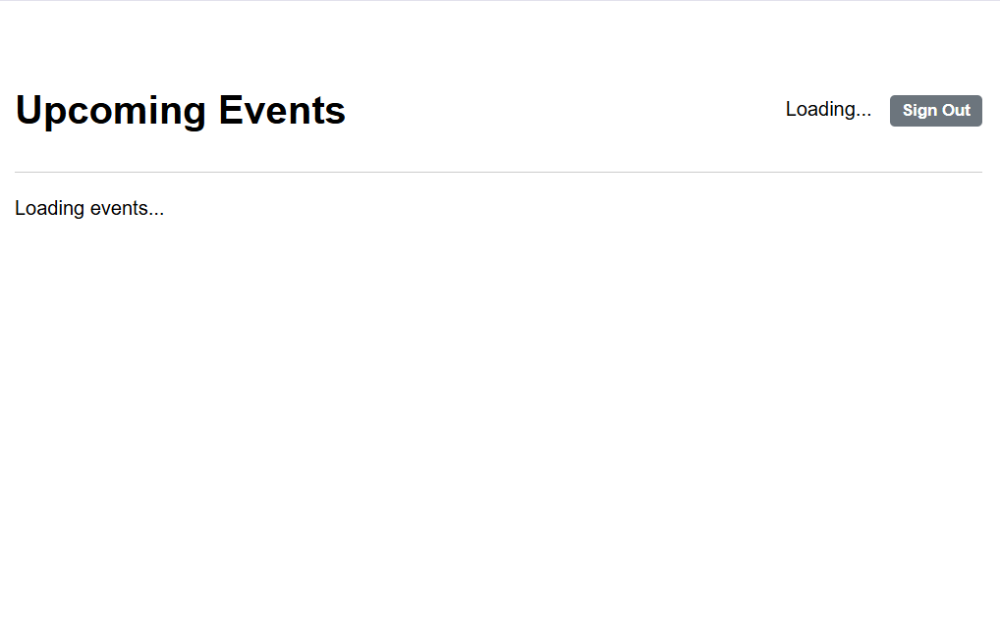
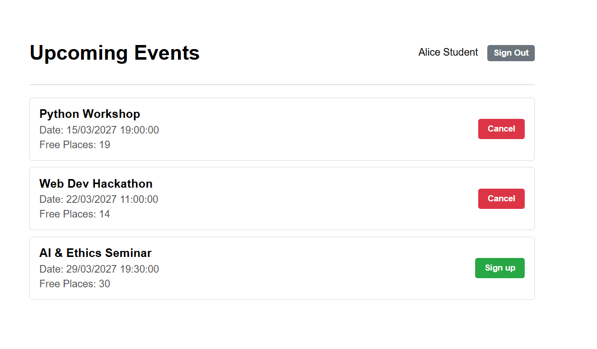
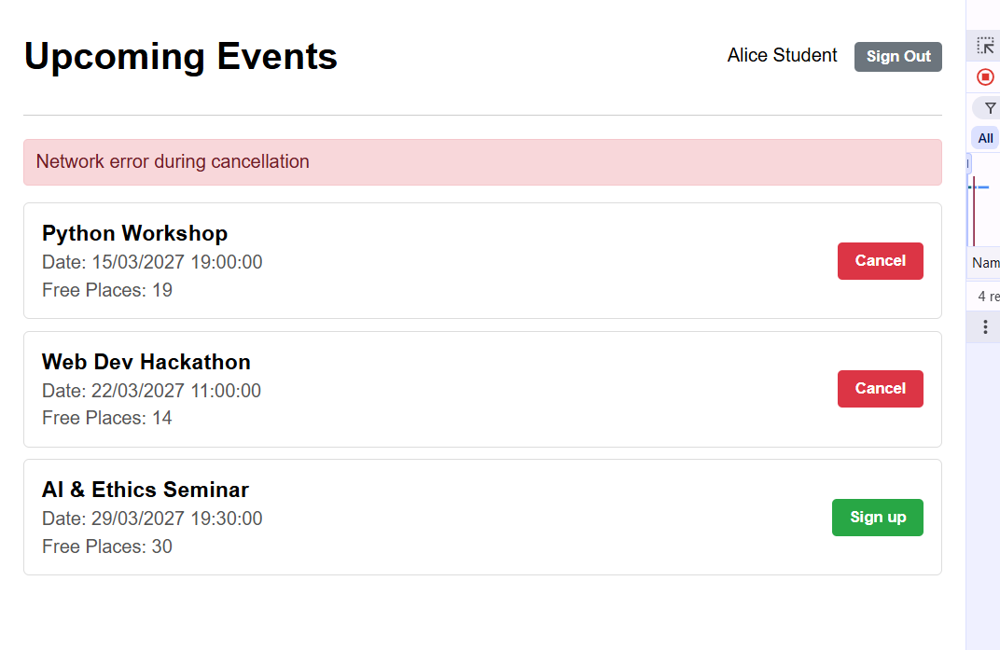
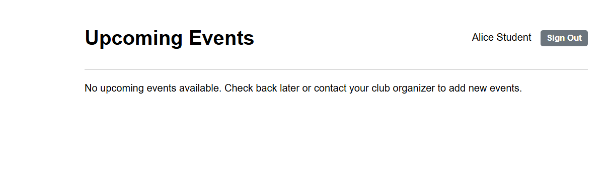
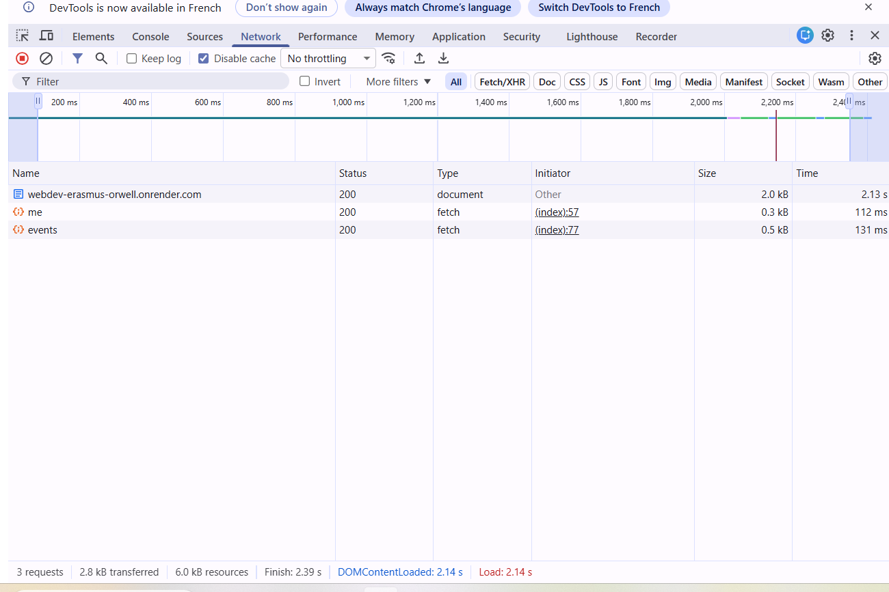
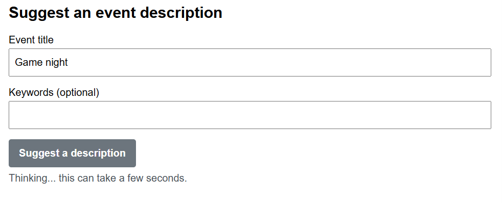
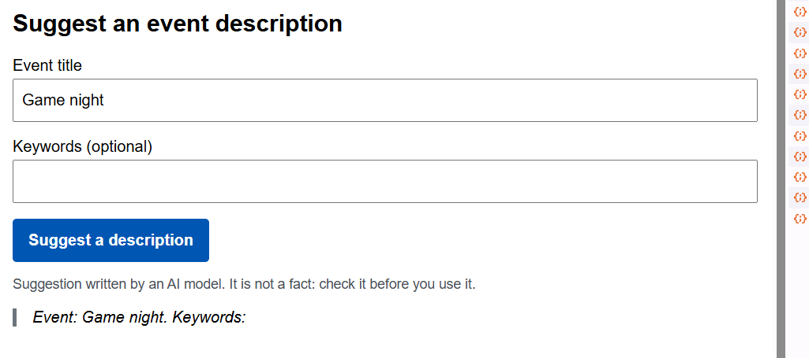
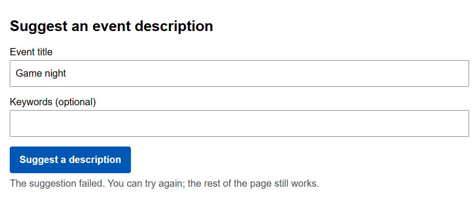

# UI checklist

<!-- Exercise 4 hands this in. Tick an item only when you have checked it, and replace
     the "how I checked" line with what you actually did. An unticked box is not a
     failure: it is a gap you then write into READINESS.md. A ticked box you cannot
     demonstrate at the defence is worse than an unticked one. -->

"Modern" is not a style. It is a short list of things a user notices when they are
missing: the screen tells you what is happening, you can get through it with a keyboard,
the text is readable, and nothing jumps around while it loads.

## Layout and typography

- [x] **One spacing scale and one type scale.** Sizes come from a small set of design tokens, not from numbers typed where they were needed.
  - how I checked: Both pages define CSS variables (--space-1 to --space-5, --text-sm, --text-md, --text-lg) and use them with var(--space-...) (grep finds them in index.html and signin.html).
- [x] **Responsive at 380, 768 and 1280 pixels wide.** No horizontal scrollbar, no text running under another element.
  - how I checked: Both pages have the viewport meta tag. In DevTools device mode I looked at 380, 768 and 1280 pixels: nothing overlaps. At 380 pixels the console test document.documentElement.scrollWidth > document.documentElement.clientWidth returned false (no horizontal scroll).
- [x] **Nothing jumps while the page loads.** Images and cards reserve their space before their content arrives.
  - how I checked: The events list reserves 280 pixels (min-height) before the data arrives. With DevTools throttling on Slow 4G, I reloaded the page and the 'Suggest an event description' block did not move when the events appeared.

## The four states, on every screen

A screen that only handles "it worked" is a screen that lies to the user on the day it matters.

- [x] **Loading.** Something tells the user the app is working, within about 100 ms.
  - how I checked: I slowed the network in DevTools (throttling) on the live site and saw 'Loading events...' (docs/ui/events-loading.png).
- [x] **Empty.** The screen says what this list is for and what to do next, instead of showing nothing.
  - how I checked: I emptied the events and saw the message 'No upcoming events available. Check back later...' (docs/ui/events-empty.png).
- [x] **Error.** A sentence a person can read. Never a raw JSON body, never a stack trace, never just "Error".
  - how I checked: I switched DevTools to Offline and saw a red banner with a readable sentence, no JSON or stack trace (docs/ui/events-error.png).
- [x] **Success.** The user can see that what they did took effect, without reloading the page to find out.
  - how I checked: I signed up for an event on the live site: the button became Cancel and the free places changed without a manual reload.

## Keyboard and accessibility

- [x] **The main flow works with the keyboard alone.** Sign in, do the core action, sign out, without touching the mouse.
  - how I checked: I signed in (Tab, Tab, Enter), signed up for an event and signed out using only Tab and Enter, without touching the mouse.
- [x] **The focused element is visible.** A `:focus-visible` outline that is not switched off.
  - how I checked: The CSS has a :focus-visible rule (3 pixel blue outline, nothing switched off) in both pages, and I saw the blue outline on every element while tabbing.
- [x] **Text contrast is at least 4.5:1.** Name the tool you measured with.
  - how I checked: I measured every text and background colour pair of the pages with a Python script using the official WCAG contrast formula: all pairs are 4.5:1 or more (I darkened the green and blue buttons, which were too light).
- [x] **Every input has a label** a screen reader reads, not just placeholder text.
  - how I checked: grep '<label\|<input' shows that email and password in signin.html each have a <label for=...>; index.html has no input.
- [x] **The page has a correct `<title>` and `lang`.**
  - how I checked: grep '<title>\|<html' shows <html lang="en"> and a title on both pages ('Upcoming Events - Club Events', 'Sign In - Club Events').
- [x] **Touch targets are at least 44 pixels.**
  - how I checked: Buttons and inputs have min-height: 44px (and buttons min-width: 44px) in the CSS of both pages (grep). I did not test on a real phone.

## The model feature

- [x] **It shows that it is thinking.** A model call is slow and a free service may have been asleep; a frozen button is the worst possible answer.
  - how I checked: With DevTools throttling on Slow 4G I clicked 'Suggest a description': the button is disabled and 'Thinking... this can take a few seconds.' is shown (docs/ui/model-thinking.png).
- [x] **It shows when it failed,** and the rest of the screen still works.
  - how I checked: With DevTools set to Offline I clicked the button: the sentence 'The suggestion failed... the rest of the page still works.' appears and the events list stays usable (docs/ui/model-failed.png).
- [x] **The user can tell the model's suggestion from a fact.** It is labelled as a suggestion, not presented as data the app knows.
  - how I checked: The result is shown under the label 'Suggestion written by an AI model. It is not a fact: check it before you use it.' and in italics with a grey bar (docs/ui/model-result.png).

## Decisions

- [x] **Dark mode, or a written decision not to have one.**
  - what I decided and why: No dark mode for now. The app is small, the CSS has no dark colours (grep finds no prefers-color-scheme), and the time is better spent on the gaps above.

## Evidence

<!-- Screenshots of at least the four states of one screen, and of the model feature
     thinking and failing. A link to them is enough; they do not have to be in the repo. -->

Screenshots of the events list (one screen), stored in `docs/ui/`:

- Loading: 
- Content: 
- Error: 
- Empty: 
- Request waterfall: 

Model feature (bottom of the events page):

- Thinking: 
- Result with the suggestion label: 
- Failed: 
